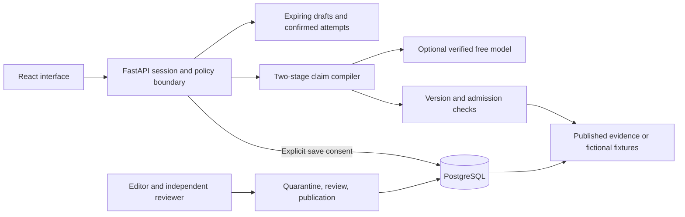

# Implemented architecture

EvidenceLoop is a single-process local application. React and TypeScript run in the browser; FastAPI serves both the interface and API; PostgreSQL stores only explicitly saved user records and the separate evidence review history. The runtime database role cannot alter the schema. The Windows launcher binds to loopback, not a public network interface.

The model proposes extraction and bounded alignment only. Exact input spans, semantic field values, known conclusion IDs, allowed relations and reviewed warrants must pass deterministic checks. The renderer uses approved source statements and bounded templates. It cannot turn a model error into a scientific finding. Unmatched replay input is explicitly manual; a replay result never claims novel model inference.

Confirmation creates a minimized immutable claim snapshot. Reconfirmation preserves previous field edits, accepts explicit unknown values and changes the attempt only when the confirmed meaning or intent changes. A changed receipt links to the prior version; the old receipt remains unchanged. The shared model ledger covers automated processing across endpoints and excludes human dwell.

Before consent, raw text and spans stay in expiring memory. Scheduled cleanup checks every minute, in addition to access-time expiry. Save atomically writes browser ownership, consent, minimized receipt, professional question and idempotency record. Saved reads and check-ins refresh a 30-day inactivity expiry. Ownership is an opaque HTTP-only, SameSite cookie; all mutations require CSRF and origin checks. The local application does not provide cross-device account recovery, public hosting, monitoring guarantees or forensic erasure of database storage.

Every source dependency is retained, including undisplayed context and limitations. Receipt reads recheck source revisions and current clinical publication. Save/check-in transactions lock the publication pointer before evidence rows, then revalidate review decisions, qualifications and due dates. A changed, expired or withdrawn dependency cannot authorize a new write.

Real clinical review is disabled by default. Editor import and operational withdrawal can only reduce eligibility. A separately configured qualified reviewer must approve exact hashes and publish a complete immutable pack. Test credentials and fictional fixture approvals are confined to disposable test schemas. Six partial NCCIH text packets are quarantined preparation material, not clinical publication authority.

The offline evaluation harness freezes source, schemas, model artifacts, evidence, cases and a declared request schedule. Candidate and baselines share a model and a bounded quota allocation. It records failures and missing attempts in denominators and creates a masked output-review queue. Its engineering fixtures are not independent clinical validation.
