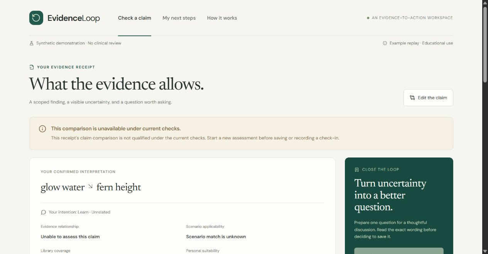

# Verification record — updated 14 October 2026

This record describes observed engineering results for the local build. It does not approve clinical use, certify model accuracy or establish hackathon eligibility.

The historical sections below preserve earlier checkpoints. For the account setup, real Gemini runs and adapter changes, see [13 October AI verification](AI_EXTRACTION_VERIFICATION_20261013.md) and [14 October AI verification](AI_EXTRACTION_VERIFICATION_20261014.md). Live application AI remains disabled; no candidate or clinical evidence library is qualified.

## Public-hosting candidate checkpoint — 14 October 2026

After the official form revealed mandatory web, video and GitHub URLs, a restricted public demonstration mode and portable Docker deployment were added. The latest full suite passed **599 Python tests plus 51 subtests** (650 JUnit total), zero failures, errors or skips, in **87.134 seconds**; report `test-results/submission-20261014-public-demo.xml`. All **35 frontend tests**, the production build and eight-schema/enum/OpenAPI export passed. The same container startup supervisor was exercised with a separate fresh Windows PostgreSQL cluster: migration, non-owner API role, readiness, Secure cookies and shutdown passed. The Linux Docker image and actual 512 MB/0.1 CPU envelope still require the prepared public-only CI smoke check; Docker is unavailable locally.

Public mode accepts only authored fictional example text, forces live AI off, blocks reviewer routes, validates the exact HTTPS origin and keeps per-browser ownership and consent controls. The interface discloses loss of saved demo records after free-host restarts. Fixed video routes and a bounded static media directory support range requests and captions. In Chrome, the built standalone video page played to 8.26 seconds with no media error and all data ready; English captions were visibly rendered in `artifacts/submission-20261014/screenshots/12-video-playback.jpg`. The player was paused after the check.

The authenticated Render workspace was verified as Hobby, with no card, no pending charges and a $0 build-spending limit. No hosting service, public repository or final submission existed at this checkpoint. See [free hosting verification](FREE_HOSTING_20261014.md) and [deployment instructions](DEPLOYMENT.md). The earlier checkpoints below remain historical results, not additional independent test samples.

## Local engineering checkpoint — 14 October 2026

The final full Python run passed **580 collected tests plus 51 subtests**, zero failures, errors or skips, in **78.482 seconds**. The ignored local report is `test-results/submission-20261014-release-final.xml`; its JUnit total of 631 includes the subtests. Command: `.venv/Scripts/python.exe -m pytest -q --tb=short --junitxml=test-results/submission-20261014-release-final.xml`. One existing Starlette/httpx deprecation warning remains. The frontend passed **34 tests across four files**, TypeScript compilation and the Vite production build. Contract export generated eight schemas, canonical enums and OpenAPI from the current source. These are engineering checks, not clinical or model qualification.

An earlier 14 October checkpoint passed 576 tests plus 51 subtests. A subsequent read-only review identified that saved receipts created by an earlier compiler could retain obsolete comparison eligibility after restart. The fix revalidates the immutable snapshot at receipt display, next-step preview, save and check-in. Current comparison status is separate from current source trust; old receipt contents remain unchanged. Tests cover manual, live and semantically edited replay receipts, plus an unchanged authored replay that remains usable after loss of ephemeral drafts. One full rerun was interrupted when the application/database was restarted during the test run; the stable rerun above passed. The failed run is retained privately and is not reported as a code pass.

The authored-comparison boundary checks both the original input hash and exact confirmed semantic fields. Generic manual/live claims and edited replay cannot acquire a directional verdict, effect judgment or saved next step by matching library nouns or enabling alignment. A separate intention-only edit does not change the authored proposition. New provider tests cover exact literal copying, optional 10–30-second extraction deadlines and explicit-length regeneration, sharing the existing two-dispatch, token and cumulative forty-second caps.

Chrome was exercised with fictional records only. The recorded walkthrough verified interpretation confirmation, source inspection, consent-gated saving, a self-reported check-in, source withdrawal and the resulting historical receipt/write restrictions. The source was then restored through the synthetic reviewer UI; restoration is not clinical approval. After restarting the final build, a new unchanged authored Fern example retained its bounded assessment and next-step preview. Changing its confirmed polarity to negated produced context only and disabled preview. The resulting screenshot is included below. These are developer browser checks, not three volunteer sessions or a real-time video recording.

The local submission assets include a ten-slide editable deck, 1280×720 cover, captions and an explicitly labeled recorded screenshot walkthrough with synthetic offline narration. The final MP4 is H.264/AAC, **363.783 seconds**, and passed a complete ffmpeg decode check. The deck and narration deliberately date their numerical results to 13 October; this report records the newer code checks. No clinical outcomes, live inference, volunteer observations, public deployment or submission are implied.

Additional spending remains **$0**. The authenticated Google AI Studio project still showed **Free tier / Set up billing** on 14 October. Free-model experiments failed their semantic or operational gates; none was enabled in the application. The fresh twelve-case and eight-case partitions remain unused.

## Sponsor development verification — 13 October 2026

Authenticated WorkBuddy review of consent and source-withdrawal source excerpts produced findings and regression-test proposals. Codex corrected and implemented those proposals and ran local validation: **44 related tests passed**, with one existing dependency deprecation warning. WorkBuddy did not execute the tests. The [completed sponsor evidence package](sponsor-evidence/2026-10-13/README.md) contains four inspected public-safe captures, the sanitized result and source/artifact hashes; production logic was unchanged. The ordered withdrawal tests do not establish general concurrency correctness, and sponsor review does not constitute clinical review or runtime AI qualification.

Successful browser sign-in supersedes the earlier CLI-access blocker. Sponsor development use and its local evidence package are complete; team eligibility, organizer acceptance and final submission remain separate requirements.

## Historical AI extraction checkpoint — 30 September

The Gemini adapter, token counter, remote-processing disclosure, separate extraction/alignment controls and simplified confirmation screen are implemented. **No Gemini request has been made yet:** the private API key is absent and account-level free access with billing disabled has not been confirmed. Live extraction remains disabled. Mock transport tests verify engineering behavior; they do not establish model accuracy or account access.

The final full Python run passed **197 tests and 51 subtests** in 76.69 seconds, with zero failures, errors or skips (`test-results/ai-integration-python.xml`). The updated interface passed **21 tests across four files**, TypeScript checking and the Vite production build. Contract export generated eight schemas, canonical TypeScript enums and OpenAPI. The npm audit reported zero vulnerabilities at this check. One existing Starlette/httpx deprecation warning remains.

New checks cover native Gemini counting with header-only credentials, bounded response size, timeouts, quota failures, schema/text preservation and invalid request rejection; explicit permission for remote capture; extraction-only operation without AI alignment; and confirmed unknown fields remaining unknown while blocking evidence conclusions and saving. Invalid Gemini configuration now disables the provider and direct calls without breaking local replay. Routine tests disable real inference and use fake transports.

Browser inspection confirmed the built summary-first interpretation card. This screenshot uses a labeled fictional replay example and is **not evidence of live AI extraction**:

After restarting the API with the final code, a separate new fictional claim was tested in manual fallback. Its unspecified fields were explicitly confirmed unchanged; the result requested clarification, reported missing evidence-comparison details and disabled the next-step preview/save path. No model request was made in that browser check.

The new [extraction benchmark](../evals/extraction/README.md) has 12 frozen development cases and 12 frozen validation cases, all developer-authored and fictional. The validation set has not been used for prompt tuning by the integration owner. Real latency, semantic accuracy and unknown preservation remain unmeasured for Gemini. The bounded probe records failed attempts, code hashes and quota use; it does not enable the application automatically.

Latest local ONNX diagnostics recorded **4 exact matches in 28 attempts** across repeated development variants. Some warm requests became faster, but incorrect roles, missing fields and negation errors remain. These are diagnostic attempts, not 28 independent cases; the model is not qualified. See [the preserved summary](../evals/development/lean-runtime-summary.json).

## Earlier local-demo automated checks

| Check | Observed result |
| --- | --- |
| Python domain, API, PostgreSQL, review, compiler, provider and evaluation suite | 132 collected tests plus 39 subtests passed; 171 JUnit records, zero failures, errors or skips; 40.662 seconds |
| React interface tests | 15 passed across three files |
| Production interface build | TypeScript and Vite build passed |
| npm dependency audit | Zero reported vulnerabilities, including development dependencies, at this check |
| Contract export | Eight JSON schemas, canonical TypeScript enums and OpenAPI generated |
| Frozen engineering replay | 17/17 declared developer state/route checks passed; zero model calls; code hashes unchanged during the run |
| Local service health | PostgreSQL schema version 2, replay mode, scheduled retention cleanup available |

Commands: `python -m pytest -q --junitxml=test-results/python.xml`, `npm test -- --run`, `npm run build`, `npm audit --json`, `python scripts/export_contracts.py`, and `python -m evals.harness --full-batch --output evals/harness/runs/engineering-20260930-release-candidate`. Python commands used the project virtual environment; npm commands ran in `apps/web`.

The suite emitted one Starlette/httpx test-client deprecation warning. It did not fail a test. Raw local JUnit output is under ignored `test-results/python.xml`. The final replay's [summary](../evals/harness/runs/engineering-20260930-release-candidate/summary.json) and [frozen manifest](../evals/harness/runs/engineering-20260930-release-candidate/manifest.json) are included in the source package. The prepared GitHub Actions workflow has not run remotely.

The final regressions include immutable receipt lineage, cumulative per-proposition edits, explicit clearing of intention, blocking old previews after changed or incomplete confirmation, quotation/value grounding, source withdrawal and independent publication validity at the persistence boundary. A failed interpretation confirmation blocks further writes from the related old receipt until valid confirmation. Current claim-edit tracking is session-local; it is not a cross-device longitudinal medical record.

## Browser inspection

The final built interface was served at `http://127.0.0.1:8765` and exercised in the in-app browser: fictional example capture, explicit field confirmation, scoped receipt, exact question preview, initially disabled save button, explicit consent and successful retrieval in My next steps. Earlier checks in the same implementation session exercised a self-reported check-in, transfer exercise, urgent stopping route and authenticated editor inspection of the six quarantined source packets. No clinical approval or source withdrawal was performed during this browser inspection.

## Actual free-model results

Live inference is disabled. The three Qwen 1.5B Kaggle version 4 outputs took 14.458, 14.208 and 14.319 seconds, exceeding the 10-second extraction budget. They also contained semantic errors; the corrected quotation grounding guard rejected all three recorded candidates. Local ONNX inference and a bounded cancellation exercise ran, but no tested model met the application's release requirements. See [free inference records](FREE_INFERENCE.md), including the unsuccessful attempts. Replay timings must not be reported as model latency.

Additional paid services or purchases: none. The observed remaining Kaggle quota was 29.85 GPU hours and 20 TPU hours; quota availability can change. Experimental model servers are stopped. The local application and database remain available for inspection.

## Remaining release requirements

- A model that meets extraction, alignment and measured end-to-end performance gates within free resources.
- Independent qualified clinical evidence and wording review; six partial NCCIH imports are quarantined, with no clinical publication.
- Reviewed gold cases, independent sealed holdout custody, live comparisons, output support and safety audit, and the release decision specified in the evaluation plan.
- Confirmed Singapore team eligibility, organizer acceptance of the completed sponsor-use evidence and final submission requirements.

No public repository, hosted service or competition entry has been submitted. These unresolved requirements prevent calling the full healthcare project or hackathon entry complete.
