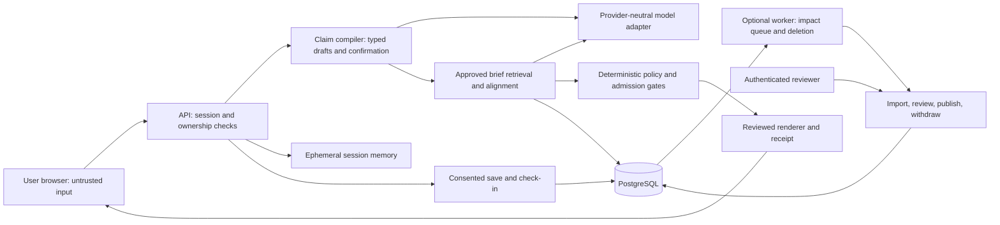
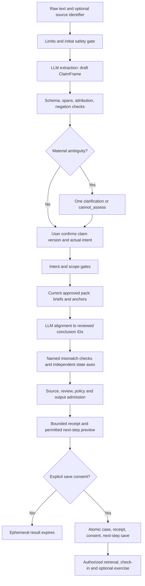

# Architecture, repository, database and API contracts

Status: PROPOSED, 30 September 2026. DECISIONS.md owns canonical state vocabulary. This is a specification, not an implemented schema, API or repository. Code-shaped examples below describe contracts only.

## Architecture and trust boundaries

Use a modular monolith: React/TypeScript/Vite frontend, FastAPI/Pydantic API, PostgreSQL, a model adapter, and a small worker process only when recall/deletion work needs background execution. [FastAPI](https://fastapi.tiangolo.com/features/) supplies OpenAPI integration; [Pydantic strict validation](https://docs.pydantic.dev/latest/concepts/strict_mode/) helps reject coercion. Neither establishes factual truth. PostgreSQL [full-text search](https://www.postgresql.org/docs/current/textsearch-intro.html) supports the small-corpus retrieval proposal; pin and test actual package/database versions at M0, after build approval.



The model has no database credentials, executable tools, network-fetch permissions, message delivery or approval authority. The browser may request actions; the API derives owner and role from the session. Clinical reviewers can publish evidence, but the application still validates every output. Evidence ingestion is quarantine, not approval. Developer tools operate in a separate workspace with synthetic data.

## Input-to-receipt data flow



Any urgent route can short-circuit the educational path. A model/anchor failure routes to a system limitation. Confirmation freezes the exact frame; assessment does not secretly re-extract it. The current trust state is rechecked after inference and before saving to prevent a withdrawal during a request from slipping through.

## Runtime contracts and limits

Use a server-owned workflow service; the model returns candidate artifacts only. A request carries an opaque request ID and cancellation token. Proposed hard budget is 40 seconds of cumulative automated processing for extraction plus assessment, excluding human confirmation time. Each endpoint is bounded by its stage and remaining workflow budget. Editing/reconfirming creates a new metered attempt subject to session rate/cost limits; draft TTL is separate. Target automated latency is median <8 s and p95 <15 s under the specified evaluation load. Total model input/output caps are 11,000/4,000 tokens including repairs. Permit at most one schema repair per stage within remaining budget; no timeout retries or hidden SDK retries.

Draft sessions are server memory, 30-minute inactivity TTL and two-hour absolute cap, bound to an HttpOnly/Secure/SameSite session cookie; no raw input in logs, analytics or browser localStorage. One API instance is sufficient for demo. A restart loses unsaved drafts and tells the user to re-enter them. Multiple instances and durable anonymous sessions are deferred. Saving promotes only confirmed normalized fields and the exact approved next-step preview into PostgreSQL in one transaction. Original input text, raw quotation text and normalization maps are never saved in the submission build. Hashes and original offsets may remain, but cannot reconstruct the original message after expiry; the receipt audits the confirmed claim version, not a retained raw-message transcript. Evidence-source passages are separate licensed public content and remain preserved for scientific traceability.

Public evidence bundles may be cached by pack/version/digest. Personalized assessments are not shared-cached. Within a session, deduplication keys include owner/session, confirmed claim hash, confirmed intent version, evidence pack and trust revision, model/prompt/operator/policy/template versions and schema version. Every new wording edit revalidates and reconfirms relevant changes. Cache reuse cannot bypass live trust-state checks.

## Exact proposed repository tree

No directories below have been scaffolded. File names are implementation targets.

```text
evidenceloop/
  AGENTS.md
  apps/web/src/
    app/                     routes.tsx, session.ts
    capture/                 CapturePage.tsx, ConfirmClaim.tsx
    assessment/              AssessmentPage.tsx, LeapView.tsx, ReceiptPanel.tsx
    follow_through/          NextStepPage.tsx, CheckIn.tsx, Exercise.tsx
    reviewer/                ReviewQueue.tsx, ReviewDetail.tsx
    shared/                  api.ts, status-labels.ts, accessible-controls.tsx
  services/api/app/
    main.py
    contracts/               claim.py, evidence.py, assessment.py, requests.py
    workflow/                interpret.py, assess.py, save.py
    claims/                  extract.py, confirm.py, normalize.py, diff.py
    comparison/              align.py, operators.py, graph.py
    evidence/                registry.py, retrieve.py, anchors.py, publish.py
    policy/                  gates.py, routes.py, admission.py
    receipts/                render.py, versions.py, dependencies.py
    follow_through/          templates.py, consent.py, steps.py, checkins.py
    review/                  queue.py, decisions.py, source_events.py
    models/                  adapter.py, provider.py, fixture_adapter.py
    security/                sessions.py, ownership.py, roles.py, redaction.py
    persistence/             tables.py, repositories.py, transactions.py
    operations/              audit.py, metrics.py, kill_switch.py
  workers/                   runner.py, impact.py, expiry.py
  contracts/                 exported JSON schemas, openapi.json, generated TS types
  evidence/
    quarantine/              metadata and permitted excerpts for review
    packs/                   immutable approved pack manifests and reviewer summaries
    templates/               approved explanation and question-template versions
    provenance/              rights and source/study relationships
  evals/
    development/ validation/ sealed_test/ safety_sentinels/
    annotation/              rubric, label guide, adjudication record
    harness/                 run.py, score.py, compare.py
    manifests/ results/      configuration manifests and immutable run outputs
  fixtures/demo/             synthetic claims, accounts, model replay artifacts
  tests/
    unit/ integration/ security/ contract/ browser/
  docs/                      these planning documents and future runbooks
  infra/                     containers, migrations, deployment and restore definitions
```

| Directory/module | Owns; dependencies | Must not contain |
|---|---|---|
| web/app and shared | Navigation, API client, accessible state labels; generated contracts | Clinical state inference from prose or copied backend policy |
| capture | Input and exact confirmation; claim contracts | Silent normalization or consent inference |
| assessment | Structured result, leap and receipt; assessment contracts | Client-generated verdicts or confidence numbers |
| follow_through UI | Preview, save, retrieval, self-report and fixed exercise; API | Treatment instructions or browser-only authorization |
| reviewer UI | Diff and decision workflow; authenticated review API | Publication through client role flags |
| API contracts | Canonical strict types and enums; standard validation | I/O or model calls |
| workflow | Request orchestration; domain modules | Medical rules hidden in route handlers |
| claims/comparison | Typed extraction, confirmation, semantic comparison and operators; model adapter/contracts | Source publication or persistence consent |
| evidence | Eligibility, anchoring, retrieval, pack publication; persistence/review | Auto-approval from an LLM or arbitrary runtime URLs |
| policy | Gates, route precedence, admission; contracts/reviewed configuration | Model-dependent permissions or generated treatment choices |
| receipts | Deterministic rendering, version links and dependencies; evidence/policy | Fabricated source text or mutable scientific history |
| follow_through API | Approved templates, consent and state transitions; ownership/persistence | Clinical goal creation or automatic writes on assessment |
| review | Reviewer queue, decisions, synthetic source events; roles/evidence | Public approval endpoints |
| models | Provider capability negotiation, timeouts, structured outputs, fixture boundary | Business rules, raw unrestricted CoT storage or tool authority |
| security | Auth/session/role checks and redaction; deployment config | Approval by claims in a request body |
| persistence | Transactions and schema; contracts | Rendering or model invocation inside DB transactions |
| operations | Sanitized metrics/audit and feature flags | Personal raw prompts, secrets or long-term analytics profiles |
| workers | Idempotent impact/expiry jobs; same domain code and DB | Independent clinical decisions or new microservice policy copies |
| contracts root | Generated export artifacts for clients/evaluators | Manually divergent second source of truth |
| evidence files | Reviewed content/rights/versions; import workflow | Sealed benchmark labels or real user records |
| evals | Splits, review guide, controlled runner and measurements | Production endpoints that expose gold labels |
| fixtures and tests | Synthetic executable scenarios and negative checks | Patient data or tests that only mirror implementation |
| docs and infra | Decisions/runbooks; deployment/migrations | Secrets, fabricated approval or content-license grants |

Dependency rule: UI -> contracts/API; workflow -> domain services -> contracts and repository interfaces. Models implement a domain port. Policy does not depend on UI/provider SDKs. Evaluation calls the same workflow through a test adapter. Migrations belong to one release stream. Export schemas from canonical Python contracts rather than hand-maintaining Python/TypeScript enums separately.

## Initial relational model

Common conventions: UUID primary keys; UTC timestamptz; immutable version rows; JSONB only for typed, schema-versioned structures, not unvalidated arbitrary responses. Every personal root has owner_id. Use database constraints for uniqueness and transaction invariants, plus explicit owner/role checks. The following is an initial logical model; optional tables are deferred without weakening core dependencies.

| Table | Primary/foreign keys and important columns | Indexes and invariant |
|---|---|---|
| users | id PK; auth_subject unique; account_kind=synthetic_demo/reviewer; created_at, disabled_at | Unique auth_subject; no diagnosis/profile table |
| role_grants | (user_id FK users, role) PK; granted_by FK users, expires_at | Role check on every review write; no public self-grant |
| consent_events | id PK; owner_id FK users; purpose, scope_hash, object_ref, policy_version, granted_at, withdrawn_at | (owner_id,purpose,granted_at); append withdrawal event, retain minimal lawful audit only |
| cases | id PK; owner_id FK users; save_consent_id FK consent_events; synthetic flag, created_at, last_access_at | (owner_id,created_at); no row before save |
| claims | id PK; case_id FK cases; claim_order, current_version_id | Unique(case_id,claim_order); current pointer must reference own version |
| claim_versions | id PK; claim_id FK claims; revision, persisted_frame_json:ConfirmedClaimSnapshot, schema_version, input_hash, parent_id FK self, confirmed_at | Unique(claim_id,revision); immutable confirmed fields; no original_text, raw quotes or normalization map |
| user_intents | id PK; case_id FK cases; claim_version_id FK; revision, action, endorsement, current_care_relation, confirmed_at | (case_id,revision); preserve quoted action separately in frame |
| sources | id PK; canonical_id unique; title, publisher, rights_basis, origin_group_ids JSONB array | canonical_id and GIN(origin_group_ids); overlapping reviews may belong to several study/cohort groups; identifier is not authority |
| source_versions | id PK; source_id FK; version, content_digest, locator_manifest, retrieved_at, publication_date, access_extent | Unique(source_id,version); immutable excerpt/context; actual rights determine stored content |
| evidence_briefs | id PK as version ID; family_key, revision, parent_id FK self; scope_json, conclusions_json, caveats_json, change_criteria, review_due_at | Unique(family_key,revision); conclusion/anchor IDs immutable; review state is separate |
| evidence_anchors | id PK; source_version_id FK; locator_json, quote/context or licensed reference, normalized_digest | (source_version_id,id); every cited quote resolves and matches |
| brief_anchors | (brief_id FK, anchor_id FK, role) PK; conclusion_id, relation, independence_group | Index(anchor_id,brief_id); support and limitation included |
| reviews | id PK; object_kind, object_id, object_revision; reviewer_id FK users; decision, rationale, timestamp, qualifications_ref | (object_kind,object_id,timestamp); allowlisted target types validated; no model actor as clinical reviewer |
| evidence_packs | id PK; version unique, manifest_json, digest, published_at, published_by FK | Immutable membership; atomic publication |
| evidence_state | object_kind, object_id composite PK; eligibility_state, trust_revision, effective_at, event_id | Index(eligibility_state); mutable trust overlay; publication/withdrawal increments revision |
| assessments | id PK; case_id FK; claim_version_id FK; intent_id FK; pack_id FK; result_json, versions_json, origin, assessed_at | (case_id,assessed_at); frozen exact input version; no raw CoT |
| assessment_evidence | (assessment_id FK, brief_id FK, anchor_id FK) PK; conclusion_ids, relation | Reverse indexes (brief_id,assessment_id), (anchor_id,assessment_id) for impact lookup |
| evidence_receipts | id PK; assessment_id FK; revision, parent_receipt_id FK self; rendered_fields_json, digest, created_at | Unique(assessment_id,revision); immutable historical snapshot; read adds current trust status |
| next_step_templates | id PK as version ID; template_key, revision, allowed_fields, exclusions, text, review_due_at | Unique(template_key,revision); reviewer state via reviews/evidence_state |
| saved_next_steps | id PK; owner_id FK; receipt_id FK; template_id FK; consent_id FK; approved_text, state, version, due_at optional | (owner_id,state,due_at); exact preview hash must match save |
| check_ins | id PK; next_step_id FK; consent_id FK; state, created_at, synthetic flag, exercise_result_json optional | (next_step_id,created_at); no inferred clinical outcome; idempotency applies |
| model_runs | id PK; assessment_id nullable FK; request_id, stage, provider/model IDs, prompt/schema versions, timing/tokens, outcome_code, redacted_artifact_hash | request_id, (stage,outcome_code); personal artifacts stay ephemeral unless saved; synthetic evaluation outputs stored separately |
| audit_events | id PK; actor_id nullable FK; action, target_ref, prior/new version, outcome, at, correlation_id | (target_ref,at); append-only permissions; no raw health text |
| idempotency_keys | (owner_id,operation,key) PK; request_digest, response_ref, expires_at | Same key/different body ->409; remove personal references on deletion |
| evaluation_cases | id PK; family_cluster, partition, pair_id, input_fixture_ref, gold_version, reviewer_id, schema_version | (partition,family_cluster), pair_id; operationally in evaluation-only DB/schema, not production-readable |
| evaluation_runs | id PK; manifest_digest, system_variant, started_at, results_ref, frozen_config | Immutable primary run; fixes produce new labeled runs |
| source_events (stretch) | id PK; source_id FK; old/new source_version_id FKs; kind, synthetic flag, materiality_state | Unique(source_id,old_version,new_version,kind) |
| recall_reviews (stretch) | id PK; source_event_id FK; brief_id FK; reviewer_id FK; decision, approved_notice_template, at | Unique(event,brief); no automatic treatment notice |
| recall_impacts (stretch) | (source_event_id FK, receipt_id FK) PK; current_state, replacement_receipt_id FK nullable | Exact impacted set; deleting receipt removes personal dependency |
| notice_outbox (future) | id PK; impact_id, owner_id, consent_id, eligibility_revision, status | Unique(impact,owner,channel); recheck consent at send; no MVP external sender |

Template/conclusion IDs inside JSONB are resolved and validated during publication. If referential complexity becomes a real defect source, normalize them later; do not add a new service. Role grants and operational review records can share a human actor, but clinical approval requires actual qualification, not possession of an admin account.

Key transactions: (1) publish pack locks current revisions, verifies reviews/anchors/rights and updates eligible pack pointer atomically; (2) save rechecks owner, live evidence trust and exact preview/consent, inserts case through next step plus audit in one transaction; (3) withdraw updates eligibility and creates impact job before commit; (4) delete tombstones access immediately and clears dependent personal rows/job payloads, with backup expiry recorded. Scientific source history can remain because it is not the user's medical history. Audit references must be minimized or severed appropriately.

## API envelope and shared schemas

All paths are `/v1`; same-origin JSON only, proposed 6,000-code-point and 24 KiB UTF-8 text limits within a 32 KiB JSON request limit, rate limits and server-side session checks. Both character and byte limits apply. Return request_id, schema_version, saved flag and explicit state axes. UUIDs are server-issued. Errors use `{error:{code,message_key,retryable},request_id}` with no raw prompt/source secrets. HTTP 401=no session, 403=role denial, 404=absent or other owner's object, 409=stale revision/idempotency/consent conflict, 410=own expired draft, 413=too large, 422=schema invalid, 429=rate limited, 503=unavailable. A valid but uncovered health claim returns a successful structured cannot_assess outcome, not an infrastructure HTTP error.

Contract shorthand below is exact conceptual shape; `?` means optional, enum references resolve to DECISIONS.md, and all objects disallow unknown properties. Times use ISO8601 with offset. `VersionRef` is `{id:UUID,revision:int>=1}`. `ConsentGrant` is `{purpose:save_case|save_next_step|check_in|recall_in_app,scope_hash:string,accepted:true,policy_version:string}`. There is no implied bundled grant.

`AssessmentResult` = `{assessment_id,claim_version:VersionRef,intent_version:VersionRef,selected_proposition_id,context_proposition_ids_not_assessed:[],case_state,route,coverage,evidence_status,findings:[{conclusion_id,effect_direction,outcome_id,anchor_ids}],applicability,personal_suitability:"not_individually_assessed",system_status,reason_codes:[],operators:[],receipt:ReceiptEnvelope?,allowed_template_ids:[],versions:{pack,policy,model,prompt,operator,renderer,schema},saved:boolean}`. MVP assesses one selected principal proposition at a time; other extracted propositions are visibly unassessed context. Safety considers all supplied content. Different propositions never collapse into a single conflicting-evidence label. Effect direction is outcome-specific. A safety/system short-circuit uses not_assessable and empty findings; claim/intent references may be null only before confirmation. No scientific finding is fabricated.

`EvidenceReceipt` contains ID/version, confirmed claim/intent snapshots, assessed_at, supported scope and unsupported transitions, uncertainty, applicability limitations, leap records, action boundary, statement-support mappings, source versions/anchors, evidence/template review metadata, AI-assisted origin and parent receipt. `ReceiptEnvelope` wraps that immutable snapshot with mutable current_trust, ownership, consent and persistence metadata. See EVIDENCE_SYSTEM.md for authoritative receipt fields. `ClaimFrame` in the blueprint maps to `ClaimIR/1.0`; use ClaimIR in implementation exports.

| Method and path | Purpose / request schema | Response schema | Specific failure states |
|---|---|---|---|
| POST /cases/interpret | Capture. `{text:string,source_identifier?:string,scenario_kind:synthetic\|educational,locale:"en"}` | `{draft_id,expires_at,claim_draft:ClaimIR,case_state,route,system_status,clarification?:{id,options[]},saved:false}` | 413/422/429/503; malformed extraction -> needs_confirmation/clarify/model_error when manual confirmation is possible; otherwise cannot_assess; urgent input -> urgent route |
| POST /cases/{draft_id}/confirm | Freeze meaning. `{expected_revision:int,selected_proposition_id,claim_patch?:AllowedPatch,intent:IntentConfirmation,confirmation:true}` where IntentConfirmation supplies IntentIR Field values for action_kind, endorsement, target, current_care_relationship, timing and actor; server assigns IDs/version | `{claim_version,intent_version,case_state,route,system_status,required_confirmation?:[]}` | 409 changed draft; 410 TTL; material patch stays needs_confirmation unless exact proposed interpretation accepted |
| POST /cases/{draft_id}/assess | Run approved comparison. `{claim_version_id,intent_version_id,expected_pack_version?:string}` | `AssessmentResult` | 409 version mismatch/unconfirmed; coverage no-match -> cannot_assess; under-review -> system_status evidence_under_review; no auto-save |
| GET /cases/{case_id} | Retrieve owned saved case; no body | `{case_id,claim_versions,intent_versions,receipt_refs,next_step_refs,saved:true}` | 404 cross-owner/missing; minimized fields only |
| GET /receipts/{receipt_id} | Inspect owned ephemeral or saved receipt; no body | `ReceiptEnvelope` plus retrieval time | 404 ownership, 410 own expired draft; historical content under-review visibly marked |
| POST /next-steps/preview | Prepare exact permitted question. `{receipt_id,template_id,concern_code?:enum,permitted_user_text?:string}` | `{preview_id,text,preview_hash,expires_at,required_consents[],route,saved:false}` | 409 superseded trust; 422 prohibited inserted action; no write of personal data |
| POST /next-steps | Save exact preview; Idempotency-Key required. `{preview_id,preview_hash,consents:ConsentGrant[]}`; no original-text retention option | `{case_id,receipt_id,next_step_id,state:"planned",version:1,saved:true}` | 409 expired/mutated preview, withdrawn consent, changed evidence; entire transaction rollback |
| GET /next-steps | Retrieve owned steps. Query `{cursor?,limit?:1..25}` | `{items:[NextStep],next_cursor?}` | 401; owner filter cannot be overridden |
| POST /next-steps/{id}/check-ins | Self-report and optional exercise. `{expected_version,state,consent:ConsentGrant,exercise_response?:{item_id,choice_id},request_reassessment?:boolean,new_concern_text?:string}`; concern text is ephemeral and never persisted | `{check_in_id?,next_step_version,state,route,feedback_template_id?,reassessment_draft_id?,synthetic}` | 409 concurrent state; changed context opens reconfirmation before completion; urgent concern short-circuits without saving completion; no symptom record created |
| POST /consents/{id}/withdraw | Withdraw future purpose. `{expected_scope_hash}` | `{withdrawn_at,affected_capabilities[]}` | 404 ownership; cancels future in-app notice eligibility |
| DELETE /account/data | User data deletion. `{confirm:true}` and idempotency key | 202 `{deletion_id,access_disabled_at,processing_state,backup_expiry_target}` | 409 pending duplicate handled idempotently; no false immediate-backup-erasure claim |
| POST /review/sources | Editor registers quarantined content; `{metadata,rights_basis,access_extent,content_digest,anchors[]}` | `{source_id,source_version_id,state:"quarantined"}` | 403 role, 409 duplicate version, 422 bad anchor/rights |
| POST /review/briefs | Editor drafts brief. `{family_key,scope,conclusions,caveats,anchor_refs,change_criteria,expected_revision?}` | `{brief_id,revision,state:"draft"}` | 403/409/422; conclusion IDs must resolve |
| POST /review/briefs/{id}/decisions | Human review. `{expected_revision,decision:approve\|return\|withdraw,rationale,review_due_at?,qualification_ref}` | `{review_id,eligibility_state,trust_revision}` | 403 reviewer; 409 stale; 422 missing required appraisal; admin != clinical approval |
| POST /review/packs/publish | Atomic publication. `{brief_version_ids,template_version_ids,expected_trust_revision,manifest_digest}` | `{pack_id,version,published_at}` | 409 pending review/revision; 422 broken source/anchor/license/expired review |
| POST /review/sources/{id}/versions | Quarantine an update. `{parent_version_id,metadata,content_digest,anchors,synthetic:false}` | `{source_version_id,diff_ref,review_task_id}` | 403 editor; 409 wrong parent; never overwrites published version |
| GET /review/queue | Role-gated queue. `{kind?,cursor?,limit?}` | `{items:[{task_id,object_ref,reason,priority,revision}],next_cursor?}` | 403; no unnecessary user text in impact items |
| POST /review/source-events | Stretch recall injection. `{source_id,old_version,new_version,event_kind,synthetic:true}` | `{event_id,impact_count,review_task_refs[]}` | 403; duplicate returns same event; no notice sent |
| POST /review/recalls/{id}/decision | Stretch materiality review. `{expected_revision,materiality,decision,approved_notice_template_id?,affected_scope}` | `{review_id,affected_receipt_count,notice_eligibility_count}` | 409 stale; missing review/consent prevents notice; no external delivery |
| POST /admin/evaluations | Optional developer-only runner endpoint; default use CLI. `{manifest_id,variant,partition:development\|validation}` | 202 `{run_id,state:"queued"}` | 403 admin; sealed_test rejected on public app; budget exhaustion/unknown manifest rejected |
| GET /admin/evaluations/{id} | Read sanitized run status | `{run_id,state,metrics_ref?,error_ledger_ref?}` | 403; never leaks sealed labels through UI |

Critical writes use both expected revision and idempotency; an idempotency key is not authorization. Authentication provider is an implementation spike: local synthetic sessions for demo users, separate authenticated reviewer role, no public reviewer password in source. Use server-managed signed sessions and a standard maintained auth integration; verify deployment-specific CSRF and role configuration at M0/M8. Real patient onboarding is excluded.

`AllowedPatch` is `{edits:[{proposition_id,field_path,new_value}]}` with at most ten edits. Field paths must be scalar semantic fields in ClaimIR (scope, outcome, certainty, polarity or attribution), never IDs, versions, source approval, policy, provenance spans or confirmation timestamps. Server validation assigns user-edit provenance and increments the draft revision; the user confirms the exact rendered replacement. `NextStep` is `{id,receipt_id,template_id,approved_text,state,version,due_at?,created_at,retention_expires_at}`. The owner is session-derived, not client-set. Source/brief import shapes resolve to typed entities in EVIDENCE_SYSTEM.md; version IDs and approval state are server-controlled.

## Deployment, operations and recovery

The zero-cost default is a live local application and local PostgreSQL with non-owner application credentials, plus a reproducible restore procedure. A public live URL is optional under the verified handbook. Add one HTTPS host and database service only if judge access needs it and their free allowance, expiry and absence of chargeable fallback are verified. Remote deployment and its access checks are conditional on that choice; local live-flow and restore checks remain required. Keep evidence editor/reviewer capabilities separate from runtime and worker credentials. Choose Tencent infrastructure only after account, region, database availability, networking, processing location and credit terms are verified. Hosting location does not establish model-processing residency.

No internet source retrieval in assessment requests. The reviewer imports permitted content. Keep secrets outside source; model requests pass minimal confirmed text and approved excerpts, never account identifiers. Sanitize exception reporting and disable request-body logging. Monitor stage timing, schema failure, coverage/abstention reasons, anchor failures, policy routes, model usage and review age.

Restore rehearsal: rebuild from pinned lockfiles, apply migrations to an empty database, load the exact evidence pack, create synthetic accounts, restore saved synthetic case, then run ownership/withdrawal/timeout tests. A local replay adapter can replace only model calls with recorded synthetic artifacts; labels must say replay, and arbitrary unseen language is unsupported in that mode. Do not silently switch from failed live inference to prerecorded success.

Cost accounting: total model list-price equivalent = sum(input_tokens x actual input_rate + output_tokens x actual output_rate)/1,000,000 including retries. Record quota/credit consumption and actual cash spending separately. The user's additional-spending budget is zero; hosting, rights and review must use existing resources or confirmed free/donated capacity. No paid fallback is authorized. Set per-session request and token caps before demo. Measure the real provider's schema reliability and latency during M2; if it misses the budget, reduce evidence context or scope rather than removing validation.
