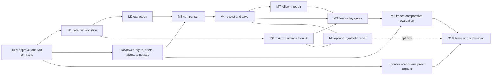

# Implementation plan and critical path

Status: PROPOSED. This document authorizes no build. The user asked for planning only. All dates/hours are planning assumptions, not promises. The public submission date is 16 October 2026; internal completion target is 15 October. Exact cutoff/time zone still needs organizer confirmation. If approval arrives later, recompute capacity instead of retaining impossible dates.

## Capacity and scope gates

Plan one developer with AI assistance for 16 calendar days at six focused hours/day: 96 hours total, 76 committed and 20 reserve. This explicitly replaces the blueprint's three-builder/255-hour assumption. Medical review is an external dependency, not something an AI assistant can supply. Reserve 18-24 qualified review hours plus 4-6 hours of independent adjudication as an estimate to validate against two sample briefs and a small output audit. Without review, retain internal synthetic health rehearsals; a public fallback may show architecture and abstract nonclinical assertions only. Do not present unreviewed health outputs or developer labels as clinical approval. That fallback would not meet clinical-example release gates.

The first complete workflow uses one family and one reviewed question template. Six families and 60 scenarios are a target only after the first vertical slice meets gates. Three families are the emergency breadth cut; evaluation claims and split counts must be rewritten, not presented as the original six-family benchmark. A smaller split cannot support the same generalization claims.

Additional monetary spending is fixed at zero. Verify eligible Singapore-based team, accepted registration, actual free CodeBuddy/WorkBuddy access and proof-capture workflow before relying on competition-specific benefits. Design work can continue while eligibility is unresolved. No account creation, registration or submission has occurred in this planning phase. Local development/demo is the default; remote hosting is optional and requires confirmed free limits without a chargeable fallback.

## Milestones

Each milestone is a small delivery unit. Safety and evaluation are designed at M0 and tested from M1; the numbered M5/M6 checkpoints harden them rather than introducing them late. All acceptance counts below are targets.

### M0 — Contracts, scope, review and repository foundation (6 h)

- Objective: after approval, establish one authoritative contract and a feasible evidence/review/sponsor path.
- Files: AGENTS.md, docs decisions/scope, services/api/app/contracts, contracts exports, tests/contract, evals/annotation, infra dependency/CI definitions.
- Dependencies: user build approval; developer capacity; actual available stack; reviewer recruitment and rules verification can run alongside local engineering.
- Acceptance: state vocabulary approved; three synthetic scenarios (supported, overclaim, no coverage) specified; schema versions and consent semantics fixed; first source rights/review slot identified; real CodeBuddy/WorkBuddy proof process started; no real health data. Map source-overlap components now to establish whether independent evaluation splits are feasible.
- Automated checks: reject unknown enum keys and contradictory Field state/value; contract export parity; CI can run minimal validation.
- Manual check: developer/reviewer explain quoted action versus user intent and source review versus output review.
- Failure condition: no reproducible environment or unresolved contract disagreements; do not proceed to broad UI work.
- Demo outcome: inspectable contract and scope map, no claimed working product.

### M1 — Deterministic vertical slice (10 h)

- Objective: exercise capture -> confirmation -> fixture alignment -> policy -> receipt without a live model.
- Files: workflow, claims/confirm, policy, evidence registry, receipts, models/fixture_adapter, fixtures/demo, web capture/assessment, tests integration.
- Dependencies: M0 and explicitly synthetic fixtures; qualified source approval is required before clinical-labeled demo content.
- Acceptance: all three scenarios traverse the same workflow; unsupported source ID/anchor prevents display; expired/unconfirmed frame fails; no assessment auto-saves; ownership bound to draft session; fixture mode badge always visible.
- Automated checks: T01/T02/T04/T06/T08 plus route/enum assertions, stale confirmation rejection and no-write side-effect assertion.
- Manual check: novel input outside recorded fixtures is rejected in replay mode, not routed to a memorized result.
- Failure: renderer accepts arbitrary model text or evidence from outside current pack.
- Demo outcome: honest deterministic walkthrough of the full central mechanism.

### M2 — Model-backed claim compiler (8 h)

- Objective: replace fixture extraction with schema-constrained model extraction without changing trust boundaries.
- Files: models adapter/provider, claims extract/normalize/diff, contracts ClaimIR/IntentIR, capture confirmation UI.
- Dependencies: M1; functioning account/API, model processing/retention settings and context budget verified.
- Acceptance: exact spans round-trip for emoji/CRLF/negation; user intent remains separate; ambiguity requests confirmation; two material pairs and two harmless controls behave as expected in development; logs exclude raw text; timeout produces explicit limitation.
- Automated checks: T07/T09/T10/T14; malformed JSON, truncation, rate limit, no hidden retries and cancellation; structured-output rejection tests.
- Manual check: inspect paraphrase, quote disagreement and adversarial advertisement examples; measure actual latency/tokens.
- Failure: persistent ambiguity errors, unsupported provider schema behavior or deadline misses; switch provider via adapter or retain labeled replay.
- Demo outcome: real extraction from previously unseen in-scope wording.

### M3 — Exact evidence comparison and Spot the Leap (10 h)

- Objective: connect confirmed frames to reviewed conclusions and named mismatch operators.
- Files: comparison align/operators/graph, evidence retrieve/anchors, web LeapView, evals development labels.
- Dependencies: M2; at least one exact approved brief and reviewed operator mappings. Broader families wait for approval.
- Acceptance: alongside/instead changes comparator/action warrant; supported narrow statement is retained; no-coverage and conflicting cases distinguish correctly; limiting evidence survives retrieval; relation to no-effect/harm outcome is independent. Recheck source-overlap components before adding families; replace overlapping candidates or report development-only evaluation if no independent split is feasible.
- Automated checks: T01/T03/T04/T05/T06/T12; fake conclusion IDs, wrong population/outcome, overlapping reports, contradictory evidence over context budget.
- Manual check: reviewer inspects every first-family conclusion, limitation and candidate operator. Document unknown rather than force a match.
- Failure: source existence accepted as support, operator applied solely from keywords, or arbitrary new clinical prose generated.
- Demo outcome: visible exact missing inference linked to source and claim facets.

### M4 — Receipt, versions and persistence boundary (6 h)

- Objective: inspectable immutable receipt and atomic promotion from draft to saved state.
- Files: receipts versions/dependencies/render, persistence, security ownership, web ReceiptPanel, consent contract.
- Dependencies: M3; approved renderer/template text; minimal database/auth path.
- Acceptance: every displayed assertion has anchor/conclusion or policy basis; saved receipt reproducible by version; fresh trust check can override current badge; explicit save only; cross-user lookup denied uniformly.
- Automated checks: T08/T13/T14/T16; save rollback, duplicate key, stale preview, withdraw-during-inference race, withdrawal before save, deletion of personal dependency.
- Manual check: inspect source passage/context and dates on phone-width layout; decline save and confirm no persistent record.
- Failure: source trust only checked at retrieval, partial save, user text in logs or stale receipt shown as current.
- Demo outcome: evidence receipt can be opened and revisited safely.

### M5 — Safety/security hardening checkpoint (8 h)

- Objective: prove policy enforcement survives malformed input, new intent, save and check-in transitions.
- Files: policy gates/routes/admission, security, operations kill switch, tests security/integration; clinician-reviewed sentinels.
- Dependencies: controls already in M1-M4; qualified reviewer for clinical sentinel labels and local escalation wording.
- Acceptance: 30 defined safety sentinels have zero critical failures; every owner/role negative test denies access; no silent continue-care or treatment-change instructions; kill switch blocks affected path; repeated unknowns cannot bypass gate.
- Automated checks: T07-T09/T12-T14/T16-T17; injection, CSRF/session authorization, role escalation, malformed template parameters, source withdrawal and model failure.
- Manual check: reviewer assesses implied advice and false reassurance, not only prohibited words. Review deployment credentials.
- Failure: any unresolved critical boundary/privacy failure; remove affected content or stop public demo of that path.
- Demo outcome: controlled failure/uncertainty cases and transparent escalation boundary.

### M6 — Evaluation harness and comparative freeze (10 h)

- Objective: measure added value and failure modes using preserved versions and independent labels.
- Files: evals harness/annotation/manifests/results, tests metamorphic, operations metrics.
- Dependencies: harness skeleton starts M0/M1; final run needs M2-M5, frozen evidence/model/prompts and independent sealed labels.
- Acceptance: target 60 reviewed cases and 30 sentinels; source-overlap components do not cross splits; same-model prompting/retrieval/compiler variants run under recorded comparable budgets; metrics include all attempted cases, safety, false rejection, coverage, sensitivity/stability, latency/cost; all gates in EVALUATION_PLAN.md pass.
- Automated checks: split leakage, immutable manifest digest, pair invariants, failed requests retained, scorer sanity cases with known outcomes.
- Manual check: blinded support audit and disagreement adjudication; inspect one remaining failure in the error ledger.
- Failure: missing qualified labels, developer saw sealed answers, cherry-picked exclusions or aggregate score hides critical failures; relabel study as exploratory/regression.
- Demo outcome: actual numerator/denominator table with a reproducible run and honest limits.

### M7 — One consented follow-through loop (5 h)

- Objective: turn the result into a useful professional question and one later reasoning interaction.
- Files: follow_through templates/consent/steps/checkins, web NextStepPage/Exercise, saved-step persistence.
- Dependencies: M4 plus M5 policy tests applied to new transitions; reviewed question/exercise.
- Acceptance: preview -> explicit save -> refresh/retrieve -> self-reported completion/defer/abandon; one optional unfamiliar reasoning item; no write from declining or timing out; simulated day controls isolated to demo mode.
- Automated checks: T14/T16/T18; duplicate save/check-in, withdrawn consent, stale template, unapproved exercise, scripted unsafe inserted text.
- Manual check: user can decline all options and understand self-report/simulation labels.
- Failure: step changes treatment, completion implies medical benefit, or background notifications appear without consent.
- Demo outcome: real persistence and check-in on a clearly simulated timeline.

### M8 — Minimal reviewer workflow (5 h)

- Objective: make governance executable without a full CMS.
- Files: review queue/decisions, evidence publish, web reviewer page, audit.
- Dependencies: review role and import/publish functions begin M1; now surface them with minimal controls.
- Acceptance: import stays quarantined; reviewer approves exact version; invalid anchors/expired review block publication; withdrawal immediately blocks new use; old receipt carries trust overlay; editor cannot approve.
- Automated checks: role matrix, compare-and-swap publication, immutable version tests, concurrent approve/withdraw and audit event presence.
- Manual check: reviewer can locate limitations, source overlap and what would change the assessment.
- Failure: a clinical approval badge can be created by an unqualified admin or a model.
- Demo outcome: evidence governance can be inspected behind the result.

### M9 — Synthetic evidence recall prototype (2 h, optional)

- Objective: show why version dependencies matter.
- Files: workers impact, review source_events, receipt dependencies, synthetic event fixture.
- Dependencies: M4/M8 and all required gates green; if core slips, reallocate these hours.
- Acceptance: synthetic update finds exactly the expected affected receipt, leaves a control unaffected, creates one review item on repeated events, and displays only approved in-app wording; no treatment advice/external sends.
- Automated checks: T11; idempotent event, dependency transitivity, consent deletion and revoked access.
- Manual check: synthetic/reviewer/pending labels remain visible throughout.
- Failure: background notice before approval, wrong affected set, missing consent or inability to clearly label simulation.
- Demo outcome: optional appendix or short governed-update example.

### M10 — Demo and submission hardening (6 h)

- Objective: deliver the actual required package with tested access and recovery.
- Files: docs demo/sponsor/results/status, infra restore, presentation/video assets, repository README.
- Dependencies: M1-M8 complete and qualifying review/gates; M9 optional; official entry eligibility and sponsor proof verified.
- Acceptance: three consecutive full rehearsals without critical failure; clean-machine setup; model/network/withdrawal fallback rehearsal; exact GitHub/link permissions verified; title/blurb/cover/process proof/description and healthcare architecture/live-demo content ready; no unsupported outcome claims.
- Automated checks: smoke flow on the live local and restored local environments, secret scan, broken-link/status checks, manifest hashes. If a free remote deployment is included, run the same smoke and authorization checks there; a public hosted URL is optional.
- Manual check: keyboard/mobile walkthrough, actual artifact access from an independent session, narration distinguishes live/synthetic/simulated/replayed/measured.
- Failure: critical bug, missing mandatory sponsor evidence, unknown eligibility or inaccessible required deliverable; address before submission.
- Demo outcome: reliable, inspectable competition entry.

Committed hours total 76, including the 2-hour optional recall spike; reserve remains 20. A spike that overruns does not consume safety/evaluation time silently. Optional recall must be dropped if it cannot finish within its slot.

## Dated execution sequence

| Date | Priority | Exit artifact |
|---|---|---|
| 30 Sep-1 Oct | M0; sponsor proof setup; reviewer start | Contracts, eligibility/rules checklist, initial synthetic cases |
| 2-3 Oct | M1 and approved first-family import | Deterministic complete flow and failure states |
| 4 Oct | M2 | Real structured extraction with span/intent tests |
| 5-6 Oct | M3 plus evidence review | Exact comparison and semantic edit behavior |
| 7 Oct | M4; start M7 | Receipt/save integrity and next-step preview |
| 8 Oct | M7 finish; M8 | Reopen/check-in and review workflow |
| 9-10 Oct | M5 hardening and M6 validation | Critical sentinels pass; freeze configuration |
| 11 Oct | M6 sealed run and blind review | Preserved primary outputs, metrics and error ledger |
| 12 Oct | Necessary fixes; post-fix regression; optional M9 | Separate original/rerun status; no silent retuning |
| 13-14 Oct | M10, reserve, recording and access checks | Final artifacts and recovery rehearsal |
| 15 Oct | Internal submission target | User-authorized submission and retained confirmation |
| 16 Oct | Published deadline buffer | No feature development; resolve submission issues |

This is a dependency schedule, not an assertion of available working hours. At the end of 3 October, if the deterministic flow is incomplete, remove M9, optional study, extra templates and breadth above three families. At 7 October, if source review is unavailable, switch explicitly to synthetic technical demonstration. At 10 October, freeze features. Any critical test failure overrides planned recording/polish.

## Dependency graph and critical path

Critical path: scope/contracts -> approved first brief -> deterministic slice -> reliable extraction/alignment -> admission/receipt -> consented follow-through -> final safety checks -> frozen evaluation -> access-checked submission. The evaluation harness, source preparation and reviewer workflow begin early; their milestone numbers do not imply waiting until the end.

Parallel opportunities: a second engineer can own UI against frozen contracts; a third can build harness/negative tests without accessing sealed labels. A qualified reviewer owns evidence, question templates and gold labels, with another reviewer adjudicating critical cases. A product helper can verify handbook/form constraints and prepare demo assets. Agents can draft code or tests after approval, but cannot provide independent clinical review or expand the admitted scope.

## First implementation ticket, only after approval

**EL-001: Build the synthetic contract-and-policy vertical slice.** Create the proposed repository and canonical strict schemas, a tiny fixture adapter and workflow entrypoint, one deterministic receipt renderer, and tests for an adjunct/replacement pair plus a no-evidence control. Do not add a runtime model until this works.

Inputs: two separately confirmed fictional ClaimIR/IntentIR pairs, one clearly synthetic evidence brief with preserved anchors, a policy version and reviewed-text placeholder labeled nonclinical. Outputs: separate state axes, named comparator mismatch, receipt dependencies, and no saved records. Both adjunct and replacement may route to professional review; only justified field differences count.

Acceptance: tests prove quoted claim is not user intent; unconfirmed version rejected; fake anchor rejected; changed intent invalidates earlier assessment; uncertainty remains explicit; no persistence happens from assessment; timeout cannot create a step. A small local capture/confirm/result page may expose these exact artifacts, with a permanent fixture badge. Deliver a diff and passing test output, not a claimed clinical capability. Estimated first unit: 4-6 focused hours within M0/M1. Only later tickets add approved medical content, database persistence and live model calls.
