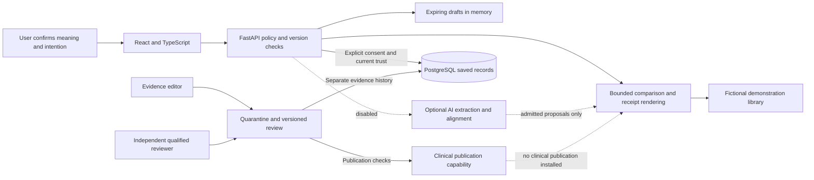

# Architecture, evidence and limits

Judge-facing technical companion. Prepared 14 October 2026 from [implemented architecture](../ARCHITECTURE.md), [build status](../BUILD_STATUS.md), the [14 October AI experiments](../AI_EXTRACTION_VERIFICATION_20261014.md), the [13 October checkpoint](../AI_EXTRACTION_VERIFICATION_20261013.md) and the [sponsor evidence package](../sponsor-evidence/2026-10-13/README.md). These dated results are not a verification of subsequent code changes. Live AI remains unqualified and disabled.

## Implemented flow

The default local demo uses fictional evidence and labeled replay/manual interpretation. The optional AI path and the clinical publication capability are implemented separately; neither is qualified for current healthcare use. The database stores saved user records and a separate evidence-review history. Importing source material does not publish it. The prepared public mode restricts input to supplied fictional examples and disables live AI and reviewer controls; the reviewer branches shown above describe the full local implementation, not capabilities exposed publicly.

## Where authority changes

| Boundary | Implemented behavior | What it does not establish |
| --- | --- | --- |
| Input to confirmed meaning | User confirmation, exact versions, explicit unknowns and separate intent; the AI adapter checks structured output and quote provenance | That an extracted proposition is medically correct or endorsed by the user merely because it was quoted |
| Source to eligible evidence | Quarantine, separate editor/reviewer authority, exact hashes, review/publication checks and source dependency tracking | Qualified review from an imported page, an AI opinion or fictional test credentials |
| Evidence to result | Bounded conclusion identifiers, templates and separate operational/evidence/action states | Individual treatment suitability, general scientific completeness or automatically correct entailment |
| Result to persistent record | Explicit consent, browser ownership, CSRF/origin checks, transactional save, idempotency and version checks | Permission for analytics, notifications or unrelated uses |
| Saved record to later action | Current source/publication checks on reads and writes; stale or withdrawn dependencies block relevant actions | Continuous monitoring of publishers or correctness under every concurrent execution |
| Check-in to interpretation | States explicitly describe self-reported follow-through | Adherence, clinician consultation, comprehension or health improvement verified by the system |

Raw unsaved text and spans remain in expiring server memory. The saved receipt minimizes the confirmed information rather than retaining the original pasted text. Saved reads and check-ins can refresh a 30-day inactivity expiry. These are implemented retention controls, not a claim of forensic deletion or regulatory certification.

## Design choices and tradeoffs

The application uses React/FastAPI/PostgreSQL with a single application instance. A non-owner runtime database role separates ordinary operations from schema migration. The web service and ephemeral loopback PostgreSQL run under a supervisor; saved fictional records may reset on free-host restart. Durable public records, multi-instance operation, cross-device identity recovery and production monitoring remain outside scope. Following user authorization, [GitHub source](https://github.com/ajayasai/EvidenceLoop) is public and Render reports Live for initial commit `6f1b125` on Singapore Free 0.1 CPU/512 MB. The [public FERN journey](https://evidenceloop-aj-001.onrender.com/) through consented save/check-in and hosted video playback were verified in Chrome. The corrected [public CI run](https://github.com/ajayasai/EvidenceLoop/actions/runs/38530016145) at `f51c764` passed the tests, build and constrained container smoke check; separate public API checks passed. Application code matches deployed `6f1b125`. Auto-deploy is off; no API secret or card was added.

The model is a bounded proposer. Extraction, evidence eligibility, user consent and scientific comparison are different checks. The current manual/live claim representation does not preserve enough directional meaning to establish support for an exact effect. Its boundary permits trusted library context while withholding support/contradiction verdicts, support links, graph warrants and save permission. Authored, unchanged replay uses a separate demonstration path. A passing extraction score alone would not resolve the comparison limitation. Review found and corrected a comparison-guard gap for legacy persisted receipts; the final 14 October test run includes that correction. Final browser checks also confirmed that editing replay polarity removes support and disables the next-step preview.

The evidence-review workflow can import, review, publish and withdraw immutable material. The installed clinical library is empty: six partial NCCIH packets are quarantine preparation, not six approved medical evidence families. The fictional demonstration and disposable test approvals must not be presented as qualified clinical review.

## Observed results

| Dated check | Observed result | Interpretation |
| --- | --- | --- |
| Latest public-hosting candidate, 14 Oct | **599 Python tests plus 51 subtests passed; 87.134 seconds; zero failures, errors or skips** (650 JUnit entries) | Includes comparison-boundary and public-demo checks. Local JUnit record: `test-results/submission-20261014-public-demo.xml`; see [verification](../VERIFICATION.md). |
| Latest frontend and interfaces, 14 Oct | **35 frontend tests** and production build passed; eight JSON schemas, enums and OpenAPI exported | Local engineering checks, not public deployment, model-quality or clinical evidence. |
| Public CI and constrained container, 14 Oct | [Run 38530016145](https://github.com/ajayasai/EvidenceLoop/actions/runs/38530016145) at `f51c764` passed 599 tests plus 51 subtests in 10.51s, 35 frontend/build, Docker build and startup smoke with 512 MiB memory, no swap and 0.1 CPU | Startup approximately 24.45s. One post-smoke memory sample was 119.5 MiB; this is not peak usage or a load test. Application code is identical to deployed `6f1b125`. |
| Separate public API checks, 14 Oct | [Public API verification](../PUBLIC_API_VERIFICATION_20261014.md) passed against the hosted service | Automated engineering verification, not clinical review or volunteer observations. |
| Supervisor and hosting readiness, 14 Oct | Windows supervisor smoke passed; public CI passed Python/frontend/build and Docker build. Render Live at `6f1b125`, Singapore Free 0.1 CPU/512 MB | Corrected CI at `f51c764` passed; separate public API checks passed. Earlier readiness-harness connection reset retained as history. Public Chrome journey/video verified separately. User approved publication/deployment/uploads; no added API secrets/card, auto-deploy off. |
| Public HTTPS journey, 14 Oct | Original FERN example → replay interpretation → confirm → Supported Within Studied Scope → preview → explicit save consent → saved → check-in consent → Done self-reported; current trust checks observed | [Public check-in capture](../../artifacts/submission-20261014/screenshots/13-public-checkin.jpg). Public no-live-AI banner visible and reviewer controls absent. One bounded fictional journey, not clinical or general usability validation. |
| Public video playback, 14 Oct | Muted and playing: currentTime 11.253323s, duration 363.782993s, readyState 4, no error | [Public video capture](../../artifacts/submission-20261014/screenshots/14-public-video.jpg). Full decode was separately verified locally; this check establishes hosted playback at the observed time. |
| Browser video playback, 14 Oct | Muted playback advanced to 8.26s / 363.783s; readyState 4, no player error; English captions visible | [Actual playback capture](../../artifacts/submission-20261014/screenshots/12-video-playback.jpg). Local playback, separate from full decode verification and future hosted access. |
| Earlier stable Python checkpoint, 14 Oct | 580 tests plus 51 subtests passed; 78.482 seconds; zero failures, errors or skips | Followed the legacy persisted-receipt correction, before public-hosting additions. Retained as dated history, not the latest count. |
| Restarted final application, 14 Oct | Fresh authored FERN replay retained support and preview eligibility; editing its polarity to negated produced `not_assessable`, context only and disabled preview, with the source still current | Actual final browser check; [replay capture](../../artifacts/submission-20261014/screenshots/10-final-replay.jpg) and [edited-claim capture](../../artifacts/submission-20261014/screenshots/11-final-edited-claim.jpg). Confirms these two observed paths, not all possible behavior. |
| Final free-model candidate, 14 Oct | Gemini 3.5 Flash-Lite, prompt 1.14, low reasoning: 12/12 admitted, median 1.914s, maximum 2.468s; strict 9/12 exact, separately adjudicated 10/12; **both qualification gates failed** | Fast responses still contained semantic errors. See the [dated report](../AI_EXTRACTION_VERIFICATION_20261014.md) for all failed runs and distinct scoring rules. Experiments stopped; live AI remains disabled and fresh final/challenge partitions were not consumed. |
| Python checkpoint after Unicode/source guard changes, 13 Oct | 499 tests plus 51 subtests passed; 85.23 seconds; one existing dependency warning | Automated engineering checks; see the dated AI report. Not clinical evaluation or a final run after future edits. |
| WorkBuddy-related consent/source review validation, 13 Oct | 44 tests passed; 51.89 seconds; five added parameter cases | Codex executed the tests. Denied consent left complete user rows unchanged; ordered withdrawal before storage blocked save/check-in. Not general concurrency proof. |
| Relevant frontend workflows after recovery changes, 13 Oct | 25 tests passed; production build passed | Documented interface/build checkpoint, not a live AI browser test. |
| Historical Gemini 3.1 Flash-Lite checkpoint, 13 Oct | Prompt 1.12, medium reasoning; 10/12 exact known regression cases; maximum 7.015 seconds; **qualification failed** | Tuned developer-authored fictional cases. This dated figure remains in deck revision 2 and its narration; it is not the latest experiment or fresh accuracy. |
| Historical frozen replay, 30 Sep | 17/17 declared developer state/route checks; zero model calls | Exercises specified fictional/policy branches. No claim about live model accuracy or latency. |
| Sponsor development use, 13 Oct | Four inspected captures and a sanitized validation log from authenticated WorkBuddy review | Genuine development contribution. Separate from organizer acceptance and runtime AI. |
| Volunteer usability / clinical outcomes | **No completed observations or clinical outcomes in this package** | Blank collection tools are supplied; do not convert planned sessions into results. |

Counts overlap across suites and dates. Do not add them to produce a new total. The earlier 14 October 576-test checkpoint preceded the persisted-receipt correction. An intervening run was interrupted when the local database was restarted during testing; its raw failure record is retained and is not the final stable result above. Failed model runs remain in the [13 October record](../AI_EXTRACTION_VERIFICATION_20261013.md) and [14 October experiment report](../AI_EXTRACTION_VERIFICATION_20261014.md). No live candidate qualified; the final/challenge partitions remain unrun at the current documented checkpoint.

## What remains unproven

Reliable live extraction on fresh cases, exact directional evidence comparison, independently reviewed clinical evidence and wording, comparative benefit over a baseline assistant, usability without coaching, and any improvement in long-term health remain unproven. The prototype's contribution is inspectable workflow and control behavior. Its next evaluation must test these distinct claims separately.

